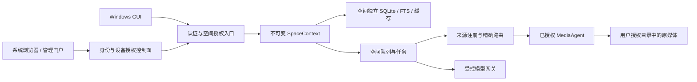
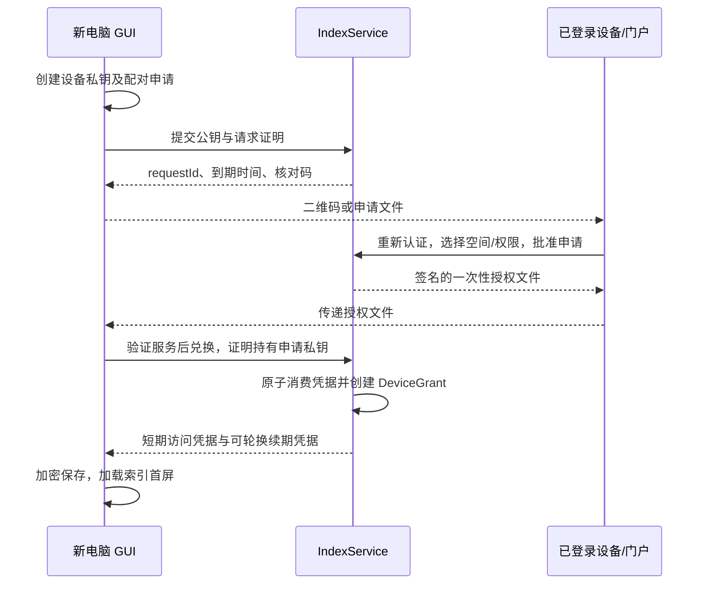

# 账号、照片空间、设备授权与跨电脑接入 SDD

版本：1.0，日期：2026-10-12。状态：专家评审后设计定稿，尚未实现。基线：v1.4.0，媒体数据库 schema 45，部署记录提交 `6734e4a`。本文是待实现的目标设计，不表示已支持账号、多租户或授权文件。现有实现仍以 [SDD](SDD.md) 和 [当前能力](CURRENT_CAPABILITIES_2026-10-09.md) 为准。本文中的“必须”是后续实现约束，参数是初始工程预算，不是已测性能结论。评审发现、修订和关闭依据见[评审汇总](ACCOUNT_SPACE_DEVICE_AUTH_REVIEW_2026-10-12.md)。

## 1. 问题、目标和范围

用户在电脑 A 添加照片/视频目录并同步索引后，应能在电脑 B 安装 GUI，通过登录或导入设备授权文件访问同一照片空间，无需抄写长期令牌或几百字节的证书公钥。原媒体仍保留在来源电脑；有索引不等于原媒体已经上传。服务不应把不同用户的数据、搜索结果、人物信息或代理路由混合。

本轮设计涵盖个人自建、家庭共享和多用户托管三种部署方式。所有方式保留纯本地离线能力；注册、登录或网络授权不能成为本地查看、索引和本地分析的前置条件。账号体系不依赖 GitHub 下载账号。发布包不携带生产地址、长期令牌、证书私钥、默认管理员密码或任何用户数据。

目标需求编号：

| 编号 | 需求与成功标准 |
| --- | --- |
| R01 | 新电脑通过登录选空间接入；不要求用户查找 JSON、环境变量或数据库 |
| R02 | 自建用户可在已信任的设备/管理门户批准新设备，导入文件完成配对 |
| R03 | 多用户共享服务时，账号、空间、设备、来源和原媒体权限有明确归属 |
| R04 | 单设备撤销不影响其他设备；成员退出后旧会话、任务、流式连接失效 |
| R05 | 跨空间所有读写、查询、缓存、后台任务和代理路由严格隔离 |
| R06 | 多来源电脑重名路径、重合数字 ID、相同内容及离线同步均可正确处理 |
| R07 | v1.4.0 数据无损迁移；保留描述、人工分类、多引用及缺失状态 |
| R08 | 保持前台响应与有界并发，后台扫描/一致性检查不成为接入或描述屏障 |
| R09 | 原媒体不因同步、迁移、撤权或删除账号被修改或删除 |
| R10 | 用户能识别同步范围、来源离线、授权过期、部分成功及恢复方法 |

不包含：公开相册分享链接、匿名媒体访问、跨空间内容去重、第三方云媒体备份、端到端加密、多区域多活、计费产品化，以及此前暂停的四项质量/硬件验收。服务端管理员在当前托管信任模型中可读取服务数据；数据库隔离不等于端到端保密。

## 2. 当前代码与必须改变的边界

| 基线证据 | 当前行为 | 目标变化 |
| --- | --- | --- |
| [ServiceSecurity.cs](../server/Picer.IndexService/ServiceSecurity.cs) | 单服务令牌；随机 32 字节；自动自签名证书；Windows DPAPI、不可用时明文回退 | 公共部署禁用共享令牌；按主体与设备签发；服务密钥有独立生命周期 |
| [IndexServiceHost.cs](../server/Picer.IndexService/IndexServiceHost.cs) | 一个 `dataRoot/picer.db`；API 比较同一 Bearer token | 先认证与授权，再取得唯一 SpaceContext 和对应数据库 |
| [AppServices.cs](../src/Picer.App/AppServices.cs) | 本地默认离线；配置已配对服务后才后台推送 | 首次明确授权同步范围；一个本地库可建立明确的空间订阅 |
| [ServiceConnectionSetup.cs](../src/Picer.App/ServiceConnectionSetup.cs) | 手输地址/令牌；确认公钥；DPAPI 保存 | 登录、文件配对及高级旧连接入口分开；原配置不作为跨机授权文件 |
| [IndexSyncClient.cs](../src/Picer.Core/Gateway/IndexSyncClient.cs) | v1 请求包含路径和本地数字 ID；存在未配置 pin 时接受证书的兼容路径 | v2 全局身份与来源映射；认证服务端且禁止无校验证书回退 |
| [AgentConnectionRegistry.cs](../server/Picer.IndexService/AgentConnectionRegistry.cs) | 部分路由无 agentId 时取在线代理；未形成空间授权关系 | 从服务器记录解析精确来源代理，不信任客户端指定 agentId |
| [MediaPool](../server/Picer.IndexService/AgentConnectionRegistry.MediaPool.cs) | 原连接按会话、路径、租约复用 | 加入空间、来源、授权代际；撤权立即清理池和租约 |
| [后台检查路由](../server/Picer.IndexService/AgentConnectionRegistry.Maintenance.cs) | 只有一个在线且支持能力的代理时工作 | 按空间、来源分批调度；不会把 A 空间的路径发送给 B 的代理 |

必须清查 HTTP、命名管道、WebSocket、后台任务和模型转发，不能只替换 HTTP Bearer 中间件。现有 HTTP v1、源任务协议和镜像数据不能仅因为字段相似就视为 v2 兼容。

## 3. 核心决策与部署形态

### 3.1 身份模型

- `Account`：人类账号。外部登录由 `(issuer, subject)` 唯一识别，不能仅靠相同邮箱合并账号。
- `Space`：照片空间，是租户及权限/存储边界。个人空间和家庭空间使用同一机制。
- `Membership`：账号在空间中的角色及状态；同一账号可加入多个空间。
- `Device`：安装实例生成的随机 UUID 和设备公钥，不使用 MAC、机器名或硬盘序列号作为认证身份。重装默认视为新设备。
- `DeviceGrant`：账号、空间、设备、客户端类型、权限及撤销代际组成的授权。GUI 与 Agent 即使同机，也有独立授权和密钥。
- `Source`：空间内的一个已注册媒体来源根。绑定 AgentGrant；路径由源端解析，服务端使用逻辑 sourceId 和相对路径。
- `Library`：本地库稳定随机 ID；每个库到空间的同步映射单独维护，不能以数字 ID 或机器路径充当全局身份。

术语上，UI 使用“账号、照片空间、设备、来源电脑”，普通用户不接触“tenant”。一个 Space 至少有一个 Owner，最后一个 Owner 不得直接退出或被移除；所有权转移要求当前 Owner 重新认证、接收者确认，事务内保证约束。

### 3.2 三种运行方式

| 模式 | 账号与信任入口 | 数据位置与行为 |
| --- | --- | --- |
| 纯本地 | 不注册、不登录 | 现有本地库和目录授权；不自动启用同步 |
| 个人自建 | 本机管理员初始化 Owner；可使用已授权设备批准新设备 | 一空间也使用相同设备授权协议；自签名服务需可信渠道配对 |
| 多用户托管 | 浏览器登录；站点可信 HTTPS；注册默认受邀请控制 | 每空间独立数据目录、数据库、缓存；不存在用户共享主令牌 |

决定：登录为主要入口，配对文件为辅助入口；个人自建不强迫配置外部身份平台。IndexService 内增加模块化控制面，初期仍以一个服务进程部署，避免用户多装一组微服务。跨进程扩展属于后续容量演进，不作为本轮交付条件。

### 3.3 组件与信任边界



入口产生 `AccountId/GrantId/DeviceId/SpaceId/Scopes/AuthEpoch`，所有仓库与任务必须显式接受此上下文。禁止使用可变静态“当前空间”，也不能从请求正文随意切换数据库。模型调用不携带 GUI 的长期凭据；模型供应商与密钥由可信服务配置决定。

## 4. 用户流程与中文交互

### 4.1 电脑 A：首次安装与启用同步

欢迎页提供“仅在本机使用”“登录并连接照片空间”“导入设备授权”。本地流程直接进入主界面。登录完成后，选择或创建空间，再选择“同步本机索引”和具体来源目录，说明会上传哪些索引信息、缩略图以及哪些 AI 请求可能转发媒体。照片、视频和人物敏感数据选项分别说明；拒绝远程授权不影响本地功能。

没有历史配置时，“登录”先显示“输入服务地址”或“导入服务连接配置”。服务管理员通过部署完成页/门户提供可复制的 HTTPS 地址，以及无秘密的 `.picer-service` 文件；其中只有服务身份与连接提示，导入后仍需验证服务信任并登录。客户端只记住已经验证的地址，不扫描局域网猜测服务，也不把 GitHub Release 当作账号门户。托管邀请的入口链接可以提供地址，但不能把链接参数中的 issuer 当作已信任配置。

本机有既有库时，先展示可取消的数据库统计与目标空间，不先全盘扫描。批准后后台建立同步快照和增量 outbox。用户仍可浏览/描述；界面显示“已上传 X，剩余 Y，失败 Z”。来源目录读取授权与同步授权独立：目录已获准本地读取，不代表允许上传其中的人脸特征、位置或描述。

### 4.2 电脑 B：登录访问

用户点击“登录”，打开系统浏览器；登录后 GUI 列出可访问空间。选择空间即创建独立设备授权，先显示目录与索引骨架，然后分批下载镜像和可见缩略图。默认作为“远程查看电脑”，不启动 Agent、不询问本机照片目录、不下载模型。用户另选“此电脑也提供媒体”时才申请 AgentGrant 并选目录。

远程模式首次完成条件是认证成功、空间有权访问和首个索引页可读；不能等待全部镜像、目录一致性核对、模型预热或原图下载才进入主界面。镜像加载期间明确显示“仍在同步，当前结果可能不完整”。

在线搜索默认查询服务端完整空间，不以尚未完整的本地镜像伪装完整结果；离线时清楚标记“仅搜索已缓存范围”和最近同步时间。未缓存的缩略图使用占位，不标 Missing；空空间直接显示“尚无媒体，可在来源电脑添加目录”。同名空间选择页同时显示服务地址与所属账号，防止误选。

### 4.3 用户要求的“登录下载授权文件，另一台电脑导入”

为了让文件只授权指定电脑，电脑 B 在“导入设备授权”中先生成公钥和配对申请，可显示二维码或保存 `.picer-request`。该申请只包含随机 requestId、公钥、服务选择及短期校验信息，不含私钥。用户在电脑 A 的已登录 GUI 或服务管理门户打开“添加设备”，导入/扫描申请，核对设备校验码，选择空间与权限，重新认证并批准，然后下载 `.picer-auth`。

首版明确只支持 B 在线登记申请，界面显示“生成配对申请需要连接服务”；不承诺断网 B 可离线生成可批准的申请。申请 15 分钟从服务登记起算，过期前必须批准；批准后兑换文件另有 15 分钟，从签发时起算，即使申请原期限过去，已批准文件仍以自己的期限为准。搬运文件本身可断网，但最终 B 必须联网兑换。超过任一阶段期限重新登记/批准并作废旧申请，禁止客户端修改 expiresAt 延长。离线生成申请留到独立协议评审后扩展，不在本轮范围。

把 `.picer-auth` 传给 B 后导入，B 验证服务身份与文件签名、展示空间及权限，再在线兑换设备凭据。正常情况导入后无需输入令牌或证书字符串。文件不能在未生成对应私钥的电脑 C 上直接使用。申请和授权可通过文件搬运，但兑换必须能连接目标服务；“离线授权”只表示传递方式，不表示服务断网时能新建远程权限。

申请归属明确区分 `subjectAccountId`（接收设备代表的人）和 `approverAccountId`（批准人）。首版未登录 B 的文件配对只允许批准者给自己添加设备，批准页显示“为我的账号添加设备”；服务在批准事务中固定 subjectAccountId。给其他成员配对必须由该成员先完成登录或接受账号邀请，并将申请绑定到其账号，Owner 仅批准范围，不把自身身份转交给对方。文件配对不隐式创建成员，也不产生 Owner 的管理门户 cookie；成员角色和 membershipVersion 在兑换时重验。

如果用户先在任意电脑登录网站再下载文件，却没有 B 的申请，网站只允许下载不含秘密的“服务连接配置”，导入后仍需登录或发起配对批准；不发行可被任意持有者无限复制的长期主令牌文件。此限制必须在下载页说清楚。



### 4.4 设备管理、错误与离线

“账号与设备”列出当前设备、最近访问、类型、所属空间、权限与连接状态。Owner 管理空间成员及来源授权，成员可撤销自己的设备；撤销自己的当前会话应明确提示并返回登录页。导出文件不提供“复制主令牌”快捷方式。

| 状态 | 用户可见说明与下一步 |
| --- | --- |
| 申请/文件过期 | “授权已过期，请在原设备重新批准”；保留空间选择，不反复尝试旧码 |
| 已被另一设备兑换/密钥不匹配 | “此授权不属于当前设备”；不能改绑或回退通用令牌 |
| 服务证书变化 | 停止发送秘密；提示核对管理员提供的新身份，不提供“忽略所有证书错误” |
| 来源离线 | 已有索引/缩略图可看；原图/视频显示“来源电脑离线”，不标记文件已删除 |
| 无权限/成员被移除 | 停止新请求和订阅，清理应用管理的空间缓存；不删除独立本地原图 |
| 网络中断 | 已许可的本地缓存可离线看，远程操作排队；不声称撤权已在离线电脑执行 |
| 空间切换 | 取消上一空间请求、播放代理和待展示结果，切换独立镜像；不得闪现上一空间缩略图 |
| 退出登录 | 默认清理远程空间缓存；“保留离线副本”须在仍有权限且空间策略允许时明确选择 |

待上传人工编辑与可重建镜像缓存分开保存。普通退出前显示未确认操作数量，提供“同步后退出”“加密保留待重新登录”“放弃待上传修改”，三者都不使退出无限等待；切空间只是暂停对应 outbox，不丢编辑。撤权后 outbox 封存且不能自动重放，重新获得权限也要重新基线并由用户确认。严格清除引起的 dataEpoch 重置优先于上述保留：旧远程上下文中的 outbox 不得保留被清媒体信息，直接清理该上下文并说明未同步修改已失效；独立本地库不因远程清除被删除。

## 5. 账号、登录与服务初始化

### 5.1 浏览器登录

采用 OIDC Authorization Code + PKCE S256，桌面应用为 public client，不内置 client secret。使用系统浏览器和随机 loopback 回调端口；校验 state、nonce、issuer、audience、redirect_uri 和 PKCE，不接受隐式流程或把用户密码交给 GUI。协议要求参考 [RFC 8252](https://www.rfc-editor.org/rfc/rfc8252.html)、[RFC 7636](https://www.rfc-editor.org/rfc/rfc7636.html) 和 [OIDC Core](https://openid.net/specs/openid-connect-core-1_0.html)。本节之外的寿命、目录和产品流程是 Picer 自身设计决策。

控制面使用成熟 OIDC/OAuth 服务端库，账号存储可使用 ASP.NET Core Identity；Identity 本身不应被误认为已经提供完整 OIDC 协议。实现前锁定支持 .NET 8、许可可分发、支持 PKCE/DPoP 的版本并加入软件物料清单和协议互操作测试，不自行拼装授权码协议。外部 OIDC 为可选适配；本地账号的密码策略、哈希升级、锁定、恢复及 MFA 由成熟身份组件承载。托管部署 Owner 和管理操作要求 MFA；不具备可用恢复渠道时不开放自助公开注册。

浏览器打不开时可使用已信任设备配对。后续如增加标准设备授权流程，必须遵守 [RFC 8628](https://www.rfc-editor.org/rfc/rfc8628.html) 的轮询间隔与降速响应；不能把自定义文件兑换接口描述成已实现该 RFC。

### 5.2 自建初始化与恢复

新服务默认 loopback。初始化命令由机器管理员在本机运行，生成单次、15 分钟有效的 bootstrap secret，写入仅服务账号可读的文件；交互式本机命令显示一次入口，不写日志或命令行参数。初始化浏览器只能在本机端口访问，或经已认证 SSH 隧道访问；互联网请求不得自动领取第一管理员。创建 Owner、默认空间及恢复码后原子标记初始化完成，bootstrap secret 永久失效。

“不使用外部账号平台”仍需创建本服务的本地 Owner 账号；重新认证使用其密码/MFA/恢复流程，普通设备私钥本身不代表近期人类认证。初次 loopback 引导使用仅回环监听的临时 bootstrap UI，秘密通过表单 POST 输入，不进入 URL；这个本机 HTTP 入口只完成 bootstrap，初始化后关闭，不能提供远程数据 API。后续门户登录使用正常可信 HTTPS；自签名部署若浏览器不能信任证书，向导提供管理员安装受信任证书或配置可信 HTTPS 的说明，不指导用户忽略浏览器警告。GUI 专用 SPKI 配对不意味着浏览器也自动信任。

bootstrap 只绑定明确的 IPv4/IPv6 回环地址，核验实际 socket peer、固定 Host/Origin 和一次性 CSRF nonce，拒绝跨站表单、DNS rebinding 与伪造转发头；不经公共反向代理暴露。临时 HTTP 仅提供无秘密的 bootstrap 页面 GET 与受 nonce/secret 保护的 bootstrap POST；生成后的登录、授权和数据接口必须 HTTPS。SSH 隧道认证不替代 bootstrap secret，首次成功后立即关闭引导监听器并清除秘密文件。

账号恢复与设备撤销不同：优先使用第二个 Owner、MFA 恢复码或已配置的账号恢复渠道。自建单 Owner 全部设备丢失时，只允许机器管理员停服务后执行受审计恢复命令；不能通过“知道旧照片路径”或“持有旧 shared token”接管账号。恢复导致账号会话、设备续期、待配对文件统一失效；不要求重建照片索引。

部署首次运行时独立生成 serviceId、账号签名密钥、文件签名密钥和 HTTPS 身份。端口和域名可变，但身份不能从 hostname 推导。默认不提供邮件服务；没有邮件配置时隐藏邮件恢复入口，给出保存恢复码和添加第二 Owner 的路径。

初始化完成页展示监听地址、HTTPS 域名/信任模式、恢复码保存状态及无秘密连接配置导出。跨机监听、防火墙/反向代理和公网开放必须由管理员明确启用，向导不自动公开服务。Linux 无本机浏览器时可使用已认证 SSH 隧道进行回环引导；自建使用此本地 Owner，家庭成员经邀请接受各自账号，托管用户使用运营方提供的地址，三者不要求编辑 JSON 才能完成客户端接入。

成员邀请单独使用短期、一次性 invitation，不携带媒体访问凭据；接收者登录自己的账号、确认空间和角色后成为成员，再创建本人设备授权。为已有登录标识发送的邀请必须匹配预期的可信账号标识，不能因客户端声称邮箱相同就接受；身份系统合并必须重新认证双方。匿名查看邀请只显示最小服务信息，不枚举空间内容。

## 6. 授权、令牌与撤销

### 6.1 权限矩阵

| 操作 | Viewer | Editor | Owner | Source Agent |
| --- | --- | --- | --- | --- |
| 查看索引、缩略图、索引检索（不调用模型） | 是 | 是 | 是 | 否 |
| 读取原图/视频 | 需独立 `media.read` 授权 | 同左 | 同左 | 只响应被授予来源的任务 |
| 编辑标签/描述/人物确认 | 否 | 是 | 是 | 不允许代替人类确认 |
| 发起分析与费用消耗 | 否 | 需 `analysis.run` 和预算 | 是，仍受预算 | 只执行已派发任务 |
| 生成式问答、查询向量模型调用 | 默认否 | 需 `answer.run` 和预算 | 需独立 AI 授权及预算 | 只执行已派发任务 |
| 上传来源索引 | 否 | 对已授权来源 | 对已授权来源 | 限绑定 sourceId |
| 彻底清除索引 | 否 | 默认否 | 需 `index.purge`、近期认证和明确确认 | 仅按任务清所属缓存 |
| 增加来源、成员、空间策略 | 否 | 默认否 | 是 | 不能扩大自身目录 |
| 邀请/授权新设备 | 只可申请 | 只可申请 | 可批准；不得超出自身权限 | 否 |
| 原文件回收站删除 | 仅源电脑本地既有授权流程；远程角色均不自动获得删除原文件能力 | — | — | 不新增远程删除入口 |

角色是权限模板。有效权限是成员权限、设备批准上限、空间策略与资源归属的交集；请求中的 role/scopes 不能成为授权依据。纯查看设备默认只给 `index.read/thumb.read`，原媒体读取在批准页单独勾选。已授权成员登录新 GUI 默认得到自身模板中的查看权限，编辑/分析/管理范围需明确批准与近期认证；不能因为登录 Owner 账号就在后台自动启用 Agent。

### 6.2 凭据格式与生命周期

| 凭据 | 初始策略 | 保存与约束 |
| --- | --- | --- |
| GUI 访问令牌 | 5 分钟 | 内存；opaque reference token，服务端摘要查找；单空间、单设备、单 audience |
| GUI 续期令牌 | 闲置 30 天、最长 90 天 | 当前用户 DPAPI；服务端只存摘要；每次轮换，绑定设备密钥 |
| Agent 访问/续期 | 5 分钟 / 闲置 90 天、最长 365 天 | 独立 AgentGrant、设备密钥与受限目录；到期提前 14/7/1 天提示 |
| 配对申请与兑换码 | 15 分钟、一次性、至少 256 位随机值 | 不进入 URL/日志；服务端摘要保存；绑定申请公钥、空间及权限 |
| Agent 媒体连接 ticket | 30 秒、一次性 | 绑定空间、grant、source、任务/租约及代际，不可跨媒体复用 |

访问令牌及续期令牌使用 DPoP 发送方约束，按 [RFC 9449](https://www.rfc-editor.org/rfc/rfc9449.html) 实现。资源请求采用 `Authorization: DPoP <access-token>`，证明包含 access token 的 `ath`；token endpoint 的授权码/刷新证明检查绑定密钥，不把 refresh token 当 access token 计算 `ath`。每次网络重试保留业务幂等 ID，但使用新的 proof/jti，处理服务 nonce challenge；重放同一 proof 必须失败。两类端点都核验方法、目标、时间窗和必要 nonce，不能靠 DPoP 自行建立人类账号身份。DPoP 不替代 TLS，也不防止控制本机进程的攻击者调用本机密钥。设备密钥优先 Windows CNG 非导出密钥；硬件保护可用时使用，但不作为普通安装的硬件要求。

密钥丢失、DPAPI 损坏或运行账号变化时，按新设备重新配对并撤销旧 grant，不回退明文。首版 Agent 保持当前用户托盘应用；如后续提供 Windows 服务安装，必须使用该服务主体独立的凭据库和 ACL，不读取交互用户的 DPAPI 文件。服务端重放包加密密钥有独立 keyId、轮换与到期清除，解密内容不进入诊断/崩溃导出。

服务端权限检查读取控制库中的有效 grant、membership、device 状态及 authEpoch，使用批量/短缓存降低开销。授权状态缓存最长 5 秒，撤销事件立即主动失效；控制库不可用或授权缓存超过期限时拒绝远程访问，不降级为仅检查 token 格式。

撤销提交后新请求目标在 5 秒内拒绝；活动媒体/AI/WS 最迟 10 秒内取消，流循环按时间重新核验而非只在连接时验一次。已经交付到播放器或第三方模型的字节无法撤回。受控原生进程需取消后等待退出，超时进程隔离/终止并记录部分取消，不保证原生调用硬实时中断。

### 6.3 轮换、并发和响应丢失

GUI/Agent 各自对同一 grant 的刷新采用 single-flight；服务端对 refresh family 做事务 CAS。请求包含幂等 requestId 且绑定同一设备证明。第一次成功生成下一令牌并使旧令牌不可再次产生后继；相同 requestId 在 30 秒内可获取加密保存的同一响应。该短期响应使用服务器专用密钥保护，不写普通日志；窗口外或不同 requestId 重用旧令牌撤销整个 family，客户端重新认证。机器崩溃后不得静默接受旧 token 以换取方便。

重放响应命中也必须重新检查账号、成员、grant、空间状态及 security/auth epoch；不能绕过撤销或角色降级。撤销事务将响应标记不可重放，敏感包由清理任务移除；物理删除失败也不能再解密返回。不同进程不共享一个 refresh family：同机多个客户端会话分别申请子会话，或通过唯一凭据代理串行刷新，避免误把合法竞争当盗用。

成员撤销/角色降级、设备撤销、账号恢复、空间冻结分别提升相关 epoch，取消续期、媒体租约、任务和待批准邀请。AgentGrant 属于明确批准的账号；该账号被移除时默认一并撤销其来源授权，Owner 可事先经源机确认转移。来源不会自动跟随机器名或另一成员登录转移。

Agent 续授通知同时出现在门户、在线 GUI 的来源列表及本机托盘，不依赖 GUI 长期打开。Owner 发起续授，源端证明持有原设备密钥，批准范围不得扩大原目录；扩大根必须再次在源机确认。过期后只能进入续授/重新配对流程，不执行媒体任务、不删除已有索引。所有绝对期限均以可注入时钟测试，不能用无限有效代理凭据绕过无人值守问题。

撤权不能保证擦除被恶意复制或长期离线的缓存。默认策略是应用收到撤销后清除其管理的空间镜像/缓存，离线到期策略只约束诚实客户端；需要严格禁止离线副本的空间不授权离线缓存，但屏幕截取等仍不在可保证范围内。

## 7. 授权文件、证书与信任建立

### 7.1 `.picer-auth` 格式

采用有版本的 UTF-8 JSON 外壳和标准 JWS 签名载荷，最多 64 KiB、最大嵌套 8 层、禁止重复键、不支持压缩或远程附件。示意字段如下，所有尖括号均为占位符，不能当作可用授权：

```json
{
  "format": "picer-device-enrollment",
  "version": 1,
  "signedPayload": "<JWS compact serialization>"
}
```

签名载荷固定包含 `serviceId, origin, issuer, enrollmentId, requestId, recipientKeyThumbprint, subjectAccountId, membershipVersion, spaceId, grantType, scopeCeiling, issuedAt, expiresAt, redemptionCode, trustMode, trustKeyId`。公钥信任材料按 trustMode 携带；文件没有媒体目录、账号密码、身份资料明文、服务端私钥、长期 refresh token 或模型 Key。请求头算法只允许已配置算法（首版 ES256），拒绝 `none`、未知关键参数及载荷提供的 `jku/x5u` 网络地址。外壳、JWS header 和 payload 都验证重复键、允许字段、类型和长度；`kid` 只是可信密钥集合中的标识，不是文件路径或 URL。

服务端签名说明内容未被修改，不自动证明签名者可信。验证顺序为：受限解析 → 检查本机申请公钥 → 展示标为“尚未验证”的目标地址 → 建立服务信任 → 从可信元数据允许的位置获取签名公钥 → 验证签名及到期 → 用户确认经验证的账号/空间/权限 → DPoP 兑换。失败前不发送 redemptionCode。serviceId、issuer 及 API origin 必须匹配已信任的配置关系；不跟随文件诱导的跨域重定向，不执行文件提供的脚本/命令。

API origin 规范化为 HTTPS scheme/host/port，拒绝 userinfo、片段、HTTP 降级和非根路径；国际化域名在确认页显示规范主机名以便识别。issuer 可以有路径，外部身份提供方也可以不同域，但 issuer、API origin、JWKS/授权/令牌端点的关系只能来自已信任管理员配置与该 issuer 的可信 discovery，不由授权文件自由扩展。服务器不根据匿名输入任意取 URL；GUI 连接内网自建地址必须由用户明确选择。

授权文件属于敏感材料，导入成功后提示删除原文件但不擅自删除用户下载目录中的文件。重新下载由门户重新发行新 enrollment 并撤销旧文件，不能复制服务端只存摘要的兑换码。文件名用产品名和时间，不带用户或照片名称。

### 7.2 一次性兑换状态机

`Requested -> Approved -> Redeeming -> Redeemed`，旁路状态为 `Denied/Expired/Revoked`。批准与兑换都需重验成员资格和权限上限，批准时有权不代表兑换时仍有权。一次性消费和新 grant/session 创建在控制库同一事务提交。

同一 requestId + recipientKey + redemption attemptId 的网络重试在重新核验全部授权状态后返回同一设备结果；初次响应的加密重放包最多保存 30 秒。不同设备、不同 attemptId 或过期重放拒绝。新 grant 初始为 `PendingActivation`，客户端持新凭据确认激活（或第一次成功的受保护请求）在事务中标记 `Active`。没有激活证据且 5 分钟到期的 grant 才由清理任务 CAS 撤销；迟到失败重试不能删除已经激活的设备。丢失响应且重放窗口已过时，界面重新申请，服务阻止同一未激活申请生成第二 grant。超时未完成的 Redeeming 通过事务恢复，不允许永久占用或双重成功。

入口按 IP、服务、requestId 和设备组合限流，匿名申请默认每 IP 每分钟 10 次、全局待批准数有上限；NAT 用户可通过登录入口恢复，不永久封禁共享 IP。短核对码只用于人类比对，不能作为唯一兑换秘密或账号恢复凭据。

### 7.3 TLS、签名键及证书轮换

托管服务使用正常主机名及受信任证书链；常规 CA 续证不要求普通用户重新抄指纹。个人自建允许固定 SPKI，首次经已信任设备/管理员的独立渠道核对，必须在发送配对申请和秘密前建立信任。文件自带的公钥不能单独作为信任根。短申请校验码只核对设备申请，不能替代独立取得的服务 SPKI 指纹；替换服务证书但保持设备公钥/短码不变仍应失败。

区分 TLS 传输密钥、OIDC 签名密钥、文件签名密钥、设备 DPoP 私钥和本地存储保护密钥。正常签名键轮换发布 old/new 公钥并覆盖最长文件寿命及允许时钟偏差；撤销密钥立即使未兑换文件失效。固定 SPKI 的计划轮换通过旧可信连接分发新公钥并保存轮换版本；旧私钥丢失或疑似泄漏时必须独立重新确认，不能仅靠旧密钥签署来证明安全。

Linux 数据与密钥目录最小权限（目录 0700、秘密文件 0600，服务专用账号），Windows 使用服务账号可读 ACL 和受保护密钥。新托管配置不允许静默降级到 world-readable、明文日志或无证书验证；Windows GUI 的 DPAPI 文件不作为可移植备份。备份密钥与业务数据库的恢复权限分离。

## 8. 数据结构与存储隔离

### 8.1 控制库和空间库

新增 `control.db` 管理账号、空间、授权与路由，不保存媒体描述、人脸向量或本地路径。每空间一个媒体 SQLite 库，复用 `PicerDatabase` 的现有表、FTS 和连续迁移。控制库使用独立类与独立的 `PRAGMA user_version` 链；它是新数据库，不给现有人物/媒体模块另起版本。实际迁移编号由实现时基线确定，本文不宣称 v46 已存在。

```text
service-root/
  control/control.db
  secrets/                         # 与业务备份分权
  spaces/<server-generated-uuid>/
    picer.db
    thumbs/ previews/ jobs/ search-cache/
    consistency-checkpoint.json
```

目录名仅使用服务器生成并从控制库取得的 UUID，不把客户端 path、spaceName 或 subject 拼入文件路径。空间库不通过 ATTACH 连接其他空间库。绝对路径仍可作为受保护的来源元数据存在于对应空间库；控制面及审计仅使用随机 ID。

| 控制实体 | 关键字段/约束 |
| --- | --- |
| accounts / external_logins | 随机 accountId、状态、认证版本；唯一 `(issuer, subject)` |
| spaces / memberships | spaceId、状态、storageKey、dataEpoch、authEpoch；唯一 `(spaceId, accountId)` |
| devices / device_keys | deviceId、客户端类型、keyThumbprint、状态；密钥更换必须重新批准 |
| grants / grant_scopes | grantId、spaceId、accountId、deviceId、kind、状态、epoch、上限 |
| refresh_families / access_sessions | token 摘要、grant、有效期、轮换序号、撤销状态；秘密不存明文 |
| enrollments / enrollment_attempts | 请求公钥、批准者、scopeCeiling、secretDigest、expires、消费结果及短期加密重放包 |
| source_routes | `(spaceId, sourceId)` → AgentGrantId、routeEpoch、状态；不存绝对目录 |
| audit_events / recovery_operations | 不透明主体 ID、动作、结果、时间、相关 requestId；不保存业务内容 |

控制库与空间库没有跨 SQLite 事务：跨库流程使用显式状态与持久化任务。创建空间先 `Provisioning` → 建库/校验 → `Active`；失败清理未开放目录或重试，不把半成品显示可用。删除空间先阻断授权并置 `Deleting`，再逐库清理，最终 `Deleted`；恢复/删除前后的清理任务可重入。关键 CAS 和幂等约束在对应库中落实，不使用内存标志模拟事务。

控制库保存 `fenceVersion/operationId/expectedEpoch`，空间库保存 `space_state.fenceVersion/dataEpoch`。首版单服务进程持有每空间写入门闩，业务提交前短暂获取写许可、重验授权并在同一空间库事务内 CAS fence；网络和模型等待不持有许可。撤权、来源转移、恢复或严格清除先在控制面持久化 `Fencing` 并阻止新许可，取消/排空旧短事务，落空间库新 fence，最后把控制状态发布为 Active。用单调版本串联两库，任何不一致保持封锁并按 journal 重试；重启不能只看一个 Active 字段恢复服务。撤权生效点是栅栏完成，之前已提交的事务计作撤销前操作。旧 HTTP、模型结果、后台检查和源任务写回均走此门闩。增加第二服务进程之前必须实现跨进程租约与同等 fence 证明，不能共用 SQLite 文件直接扩容。

### 8.2 内容、引用与跨设备身份

空间内采用 `(LibraryId, IncarnationId, EntityKind, LocalId)` 映射到稳定随机 GlobalId，由客户端首次创建实体时预分配 UUID 并与实体同事务保存；服务端校验冲突和归属，不把 UUID 难猜当授权。新增空间/来源 ID 仍由服务器登记。本地数字 ID 继续用于内部关系，v2 线协议只传全局身份和必要的来源版本。sourceId、refId、contentId、personId、faceId、albumId、tagId、video 派生项均纳入映射，不能只映射照片主表。

内容去重键为 `(SpaceId, SHA256, mediaKind)`，只在本空间共享；未知强哈希不合并。并发创建相同内容时，唯一约束事务选定 canonicalContentId，确认响应返回提交 ID 到 canonical ID 的别名映射；后续关联在本空间解析映射，不合并两个来源的位置引用。位置身份为 `(SourceId, normalizedRelativePath)`，同内容在两个来源可保留两条引用。设备 A 与 B 都有 `D:\照片\a.jpg` 时不会覆盖彼此。LibraryId 被复制到另一台电脑时须识别安装身份变化；默认“新来源”创建新 IncarnationId、GlobalId 映射、publisherId 及从零开始的 outbox 序列，不复制凭据。选择“迁移同一来源”必须显式冻结旧 publisher、完成已确认水位交接、提升 routeEpoch 后再转移，不能让两台电脑同时使用原身份。

源路径在 Agent 端以已授权根拼接，并验证最终路径、Windows junction/reparse point、大小写规则及卷身份；不得用 `..`、UNC 跳转或符号链接越出授权根。路径移动修复仅在本空间、已授权来源根中进行，确认内容后重新关联，无法确认则标记缺失而非清除。

## 9. 同步协议、人工冲突和彻底清除

### 9.1 v2 同步契约

所有发布由明确的 `(spaceId, sourceId, libraryId, publisherId)` 标识。publisherId 由服务登记；请求不能代表另一来源。每操作有 operationId、publisherSeq、baseRevision、entityGlobalId、dataEpoch；服务端分配递增空间 changeSeq。重复 operationId 返回相同确认，乱序先暂存或返回缺口，不推进已确认水位。

服务确认必须覆盖实际持久化的操作；客户端仅在确认后推进 outbox，不因 HTTP 200 就删除整批。一次 HTTP 批次上限 200 条/2 MiB，可返回逐项结果及可重试状态；初始快照分批、增量在其后按 cut 水位续接。先实体再关联，不能因跨页外键缺失丢弃人工分类。

捕获先于快照：启用同步时先安装事务性 outbox 写入边界，再取得一致性快照及 cutLocalSeq；cut 之后的本地改动必入 outbox。业务实体/人工编辑、全局 ID 映射和对应 outbox 在同一本地库事务提交。服务端实体变更、operationId+规范载荷摘要、幂等结果、连续已处理 publisher 水位和空间 changeSeq 日志在同一空间库事务提交，提交后才回包。相同 operationId 携带不同载荷返回冲突。永久拒绝/人工冲突记为终态并消费序号，依赖失败返回 dependency_failed；可重试失败不推进连续水位。批内依赖明确、短事务提交边界固定，不能以整个请求成功替代逐操作确认。客户端确认应用与 outbox 已确认标记也在同一事务提交。

镜像 cursor 绑定 serviceId、spaceId、dataEpoch、filterVersion，服务器校验签名；切空间、还原、过期或筛选变化返回 `reset_required`。完整快照使用明确 snapshotId 和 cutSeq，只有完成标记后才清理镜像拥有的旧数据；期间本地编辑独立保存在 outbox。普通成员无发布本机来源权限时只能同步已授权的元数据操作。

首版快照为独立只读 SQLite 快照文件，通过 SQLite 一致性备份 API 建立；cutSeq 存于同一快照中，不在复制前后分别猜测。每页只读该文件，不从变化中的主库重新拼历史值；不对在线库持有贯穿整个下载过程的长读事务。镜像在暂存库组装，页数据及 checkpoint 同事务提交；首屏可明确标记为未完整的暂存视图，旧完整镜像仍保留。完成实体/关联校验后可恢复地原子发布，再接 cutSeq 后增量。快照默认 TTL 30 分钟、可续至最多 2 小时；每空间最多 1 个生成任务、节点最多 2 个，磁盘预算取节点可配置上限（默认 10 GiB）。变更日志至少覆盖活跃快照 cut；资源不足或无法保留日志则使快照失效并返回 reset_required，不清空客户端旧库。生成/过期/取消均清所属临时文件，不能删除别的空间快照。

### 9.2 冲突规则

来源路径/大小/时间由其指定 publisher 提交，服务验证身份；源端离线不产生 Missing。AI 描述按输入内容哈希、模型版本及任务 revision 写入，人工修改优先，晚到推理不覆盖人工结果。

人物确认、标签/相册编辑使用 baseRevision 与服务器排序，不依赖客户端墙钟裁决；同一字段并发人工修改返回冲突记录，界面展示双方值并由有编辑权的成员选择。集合增删按独立操作 ID 和实体版本处理；否定/不分类是明确人工决策，重检测不会抹去。各模型的向量与阈值仍按模型版本隔离。

### 9.3 删除、撤权与离线重放

确认原文件缺失只更新引用状态。手动“彻底清除索引”需资源授权及用户确认，先取消在途工作，清理该引用及归属数据；最后引用才清共享内容、描述、特征、FTS、向量/问答缓存、缩略图、任务结果与模型制品归属数据。其他引用的共享数据不得误删，原文件保持不变。

遵循用户已明确的“手动清除不保留任何索引等信息”，首版默认严格清除：不为被清媒体保留 entity tombstone、ID 对照、哈希、路径、文本、缩略图或人脸数据。一次确认批次统一提升空间 dataEpoch/fence，冻结旧 publisher，将当前保留内容形成新基线；旧 outbox、旧快照、幂等缓存和关联映射不再有自动提交资格，包含被清实体的旧日志段必须清除。控制审计仅保存空间级清除动作、批次数量和代际，不保存被清媒体 ID。代价是清除后各设备需要增量以外的基线重建：客户端收到严格清除 reset 后立即停止展示/检索旧远程镜像，取消请求、关闭播放并清该空间远程缓存，只能展示新基线的暂存视图。不得因“不知道哪些项已清除”继续显示整个旧库；普通网络失败可保留旧完整视图，严格清除 reset 不适用该规则。不通过保留隐蔽媒体墓碑规避要求；未联网设备无法被遥控擦除的边界仍明确保留。

独立 `RestoreGuard` 保存每空间的单调 purgeGeneration/minRestorableBackupGeneration 与状态，不保存任何实体标记。它不随 control.db 或空间库回滚；托管部署放在独立持久化故障域的追加式存储，自建部署需独立保护并将最新屏障纳入专门恢复材料。清除先持久化 `PurgePending`、提高恢复下限并 fsync，再在封锁空间内清数据/日志/快照，最后完成新代际和 `PurgeCommitted`。崩溃时恢复下限宁高勿低，先完成清除才开放。

所有清除前的整空间备份标记为不可直接上线恢复；严格策略不保存媒体清除清单来过滤旧备份。备份清单必须带空间 purgeGeneration 和可信完整性摘要，恢复发布前与当前 RestoreGuard 比对。不能取得可信最新屏障、屏障有未完成操作或备份早于下限时，保持 Recovering 并拒绝旧库发布；不能根据一个旧备份自建“最新”屏障。全部存储含屏障被同时回滚且没有独立可信副本时，软件无法推断历史，必须拒绝旧空间恢复；可重新建空空间，但不自动导入旧备份。不可变备份中旧字节是否物理清除由备份保留策略决定，不能对用户承诺已远程擦除所有历史副本。

过旧设备（超过 90 天或 dataEpoch 已变化）必须重新拉取基线，不能直接重放旧全库快照。重置后的自动同步不将本地旧项目当作新发现；只有用户明确重新索引来源产生的新版本发现，才允许重新创建已清除项。撤销设备无写入入口，离线编辑等待用户重新授权和重新基线后逐项审核。

## 10. Agent、媒体、检索和模型隔离

### 10.1 来源授权与路由

Agent 首次配对需本机用户确认允许的目录根、空间及执行能力，生成独立凭据；GUI 登录不会自动扩大目录。服务依据 SpaceContext 查询 SourceRoute，选择绑定 AgentGrant。任意客户端传来的 agentId/path 仅是候选字段，必须与实体归属匹配；不存在时返回统一不可用结果，绝不回退任意在线代理。

每次任务绑定 `spaceId/sourceId/grantId/taskId/contentIdentity/authEpoch/dataEpoch/routeEpoch`。Agent 验证自己当前授权、任务类型与来源根；服务返回值再次核验身份和版本。来源转移要新 Agent 本机确认并提升 routeEpoch，旧任务及旧租约失效。同一 Agent 可绑定多个空间，但使用不同 grant、来源映射和隔离工作目录，不跨空间复用原图/预览连接。

### 10.2 媒体流与缓存

媒体租约绑定空间、调用设备、来源、内容版本和授权代际。复用池键包含上述全部维度，连接回收前再校验；不能只凭相同绝对路径或 ETag 共用。WS 握手、每个新子任务与长流定时检查授权；随机 ticket 只为对应已认证任务使用一次。

GUI 缓存目录包含 serviceId/spaceId/accountId，缓存键还包含内容/模型/版本。空间切换或撤权立即取消下载、禁止晚到结果发布，关闭 loopback 播放器代理及租约。外部播放器只得到本机临时单媒体地址，不得到账号或服务凭据。应用无法收回已由外部播放器独立保存的文件。

### 10.3 搜索、AI 与训练

FTS5/BM25、向量检索、结构化查询和人物别名解析仅运行在所选空间的数据库与向量目录。问答在程序确认的该空间候选集合上生成答案；LLM 不能靠回答文本要求服务切换空间。提示词/结果缓存、分析计费、训练数据、模型适配器、导出文件与任务 journal 都带空间归属。

`index.read` 只授权不调用模型的索引检索；生成式回答或查询 embedding 需要 `answer.run`、独立 AI 同意、受控模型路由和预算预留。Viewer 默认不具备此权限，点击相关功能应解释权限不足，而不是借“搜索”入口静默付费或外发内容。每一个模型入口（包括 query embedding、聊天代理和重试）都执行此检查。

共享基础模型权重可以只读复用；用户人脸原型、微调制品和训练快照不能跨空间复用。ModelServer 前放可信任务网关，选择服务器批准的模型路由；不从客户端接收任意模型 URL、路径或 Key。服务端传递最小必要内容并保留独立 AI 授权，账号登录不等于同意云模型处理。模型输出按启动快照和权限重验后才保存；撤权后不能通过后台训练回填旧数据。

## 11. API 与失败语义

以下为设计接口，不代表现有路由已提供；OIDC 标准路径由所选实现的 discovery 公布，客户端不得写死供应商路径。

| 接口 | 认证与授权 | 语义 |
| --- | --- | --- |
| `GET /.well-known/picer-service` | 公开且最小化 | serviceId、协议版本、issuer、信任方式；不返回空间列表或用户数量 |
| `GET /api/account/v2/spaces` | 账号登录会话 | 仅列该账号的 memberships |
| `POST /api/account/v2/device-grants` | 近期账号认证+设备证明 | 从本人 membership 创建本设备查看授权；超出默认范围另批准 |
| `POST /api/enrollment/v2/requests` | 已验证服务身份，匿名限流+申请密钥证明 | 建立短期申请；不授予业务访问 |
| `POST /api/enrollment/v2/requests/{id}/approve` | 空间 Owner、近期认证，门户需 CSRF | 核对申请、权限、签名并下载文件 |
| `POST /api/enrollment/v2/redeem` | 可信 TLS+一次性码+申请密钥证明 | CAS 消费及 grant 建立；禁止将码放 query |
| `GET/DELETE /api/account/v2/devices/{id}` | 本人或该空间 Owner | 只操作有权管理的 grant；平台设备范围不泄漏其他空间 |
| `/api/spaces/{spaceId}/v2/images, videos, search, thumbs` | 对应空间 grant 和 scopes | 所有实体 ID 在空间内解析；无权资源统一 404 |
| `POST /api/spaces/{spaceId}/v2/sync/batches` | 来源 publisher 或授权元数据编辑者 | 映射、epoch、幂等、逐项确认 |
| `GET /api/spaces/{spaceId}/v2/changes` | `index.read` | 签名 cursor、分页及 reset_required |
| `POST /api/spaces/{spaceId}/v2/purge-plans` | `index.purge`、近期认证 | 生成可审阅计划，执行前再次验证，不由 GET 触发 |
| `/api/agent/v2/connect` | AgentGrant+设备证明 | 服务派生身份，拒绝自行声明另一空间 |

401 表示无效或到期认证，客户端最多单次刷新后重试；403 表示操作权限不足，不通过自动重登反复重试；无权实体用 404 防枚举；409 表示 revision/epoch/消费冲突；410 表示已过期的配对或同步基线；429 带 Retry-After；503 表示服务/来源暂不可用，不能转义为媒体缺失。错误体仅含稳定 errorCode、correlationId、可安全展示的提示，不含异常栈、文件绝对路径或用户输入正文。

状态更改采用 POST/DELETE、幂等键及必要的 ETag/If-Match。cookie 门户与令牌 API 的 CSRF/CORS 策略分离，cookie 为 HttpOnly/Secure、适当 SameSite；不能用“有 Bearer 校验”推断门户 cookie 同样安全。反向代理仅信任显式配置的转发头来源，禁止任意 Host/X-Forwarded-* 修改 issuer 或回调目标。

## 12. 并发、容量和可观测性

初期每节点一个写入控制面，每空间独立 SQLite 写队列；网络/模型等待不占 SQLite 事务或全局锁。数据面按空间和设备配额做公平轮转，长视频不能占满所有缩略图槽。默认媒体每设备 4 路、每空间 8 路、每节点 32 路；缩略图每空间 8 路独立槽，节点总量配置约束。模型并发按实际模型/GPU能力配置，空间队列隔离，单个空间不得耗尽其他空间预算。

所有队列都有活动数、等待数、等待时限和取消回收；以下是初始可配置硬上限，部署可降低，不得把 0 解释成无限：

| 资源 | 活动/等待上限 | 等待与拒绝 |
| --- | --- | --- |
| 媒体原始读取 | 节点32，空间8，设备4；等待节点256/空间32/设备8 | 最多5秒，超限429；用户取消立即移除等待项 |
| 缩略图/预览 | 节点32，空间8；等待节点512/空间64 | 最多2秒；可见项优先，预取先取消；超限429 |
| 模型任务 | 节点活动数按模型容量；等待节点128/空间16 | 入队立即返回jobId，默认排队最长10分钟，超限429，持久任务有大小/保留期 |
| 空间写队列 | 每空间1个短事务；等待空间128/节点1024 | 最多5秒，503；写事务目标最长500ms，超预算取消/拆批，不降低授权 |
| 登录/授权查询 | 独立32工作槽，等待128 | 最多2秒，503；不得排在媒体任务后 |
| 撤销/账号恢复/fencing控制 | 另保留4工作槽、等待64 | 最多1秒接纳，超限明确503；不返回假成功 |
| 快照生成 | 节点2、空间1，等待节点16 | 最多30秒接纳，503；生成任务另有磁盘/总时限 |

空间轮转调度避免先到的单空间占满节点等待额度；队列项仅保存有限请求元数据，不缓存完整媒体请求体。同步请求体上限2 MiB，HTTP并发与暂存请求总字节另设64 MiB节点预算，超限在读全请求前拒绝。模型排队持久任务不持有数据库句柄或媒体流；取消/到期及时释放预算。

后台一致性检查每空间/来源独立检查点，最多一个该来源批次，前台优先，继续使用现有 32 条批量及内容审计预算；在线来源按轮转取任务，离线不积累无限重试。空间数据库上下文按 LRU 回收、默认最多 32 个打开空间，引用计数为零才能关闭；有任务时不回收。超出当前容量返回繁忙或排队，不能同时为所有租户启动无界后台线程。

数据库槽中后台最多占8个，至少8个专供前台；后台在读取候选后释放库租约，再等源端结果，写回时重新取得短租约并核验 fence。长期媒体和模型任务不得占库槽。第33个前台空间优先回收无引用上下文并取消可抢占后台租约，最多等2秒后返回带 Retry-After 的503；前台排队节点最多128。控制库不计入32个媒体库槽。必须验证慢后台来源不会长期占满32个库导致新空间饿死。

默认每空间索引配额20 GiB、可重建服务器缓存5 GiB、任务暂存2 GiB（均可配置）；快照使用另有节点10 GiB的全局预算。GUI媒体缓存继续有本机容量上限，不能按空间数无限相乘。空间及节点总量双重校验，高水位暂停新快照、分析结果预分配与后台写入，优先逐出可重建缓存，绝不自动删除索引或原媒体。节点数据卷空闲安全阈值取5 GiB和容量10%中的较大者；控制面/RestoreGuard需独立卷或具配额隔离的至少1 GiB保留空间，数据面不得消耗。无法保证保留空间的部署不进入托管模式。磁盘满导致撤销未持久化时明确失败并停止依赖授权缓存继续服务；不得报告撤销成功。配额回收、Deleting重试不持长事务。

首期容量验收固定参考机：8 核、16 GiB、SSD，服务负载数据至少 100 空间（其中 32 活跃）、每活跃空间 10 万照片及 1 万视频，64 并发 GUI 会话、16 活跃来源。此为压力模型，生产上限在测量后定，不以总空间数代替总索引容量。服务端授权路径 p95 增量预算 20 ms；已有会话首个索引页 p95 500 ms（不含公网 RTT/下载）；后台开启相较关闭的首屏 p95 回归不超过 10%。不达标先优化有界队列/缓存，不能绕过权限检查。

审计记录账号/空间/设备随机 ID、动作、结果、计数、时间、requestId，不记录令牌、兑换码、文件载荷、路径、人物名/别名、向量、AI 问题或图像。默认审计保留 30 天，短期配对记录过期后只留动作统计和不透明 ID；控制库清理可配置但不能把待消费秘密落日志。指标使用有限标签，避免每个媒体/用户形成高基数时序；管理员诊断必须有范围和导出脱敏。

## 13. 旧版本迁移、备份与发布

### 13.1 迁移顺序

1. 冻结旧公网写入口，停止全部 GUI/Agent/服务写入者与守护重启，取得 DB/WAL/SHM 独占安全检查，备份程序、数据库、媒体缓存归属和配置。模型/原媒体不迁移或删除。
2. 由机器管理员初始化控制库及恢复凭据，显式指定已有数据的 Owner。旧令牌不具有认领 Owner 的资格；多人混用的旧库不能自动按路径或人物名分租户，默认整库归入经确认的一个 legacy-space。
3. 在暂存副本中按连续迁移建立全局身份、library/source/publisher 映射和同步版本，保持原本地数字 ID、人工编辑和内容引用。对未知来源记录保留为 `UnboundSource`，可看已有索引，但禁止任意代理代读。
4. 比对表计数、引用关系、FTS/向量归属、描述/人物人工决策、多引用、缺失状态和样本媒体身份，执行 quick_check/外键检查。发布前写入可恢复迁移 journal，不提前暴露半迁移空间。
5. 将来源 Agent 逐个升级、重新配对并确认原目录，建立 source→grant 精确映射；GUI 登录/配对到 legacy-space。先受控读验证，再开放 v2 写入。
6. 关闭旧 shared token、v1 写接口和无 pin 回退，确认不存在旧 v1 活跃客户端后进入托管模式。已有凭据不被写进授权文件，旧证书可以在信任策略允许下保留。

客户端 v2 使用全新数据目录及受控活动指针，迁移 journal 记录旧库→新 library/space 的映射、校验清单与切换状态。新程序检查 storageFormat/minReaderVersion/minWriterVersion，遇到更高版本拒绝打开；不能指望未更新的 v1.4.0 理解这一标记。因此 v2 活动库不得位于旧程序会打开的默认路径，旧目录只留明确分离的副本，旧实例不能写新库；安装协调器在切换时停用旧自启项并核验维护位置。迁移失败恢复指针，不降低 user_version。保留旧程序启动可能修改其独立旧本地副本，但其 v1 服务写入口已被禁用，不能污染 v2 活动数据。

### 13.2 兼容模式与防降级

升级状态分为 `LegacySingleSpace`、`MigrationMaintenance`、`V2Ready`、`HostedMultiSpace`。LegacySingleSpace 只服务一个固定空间，旧客户端仅在隔离监听/网络白名单中可用，界面明确提示旧协议；禁止新建第二空间。MigrationMaintenance 拒绝业务写入。HostedMultiSpace 永不接受旧共享令牌，不能根据请求失败自动降级到 v1 或无 pin TLS。

初期允许保留独立旧服务实例作为只读回滚观察对象，但必须使用隔离端口与网络范围，不能指向正在写的 v2 数据库。新安装默认使用 v2，升级客户端检测旧服务时给出升级指引，不要求用户手动修复 schema。

### 13.3 备份、恢复和删除

空间内容备份与控制面授权备份分别管理，清楚说明令牌和私钥不随媒体导出共享。恢复内容库须暂停该空间发布者与任务，在控制面建立恢复操作、关闭库文件、暂存校验后发布，并提升 dataEpoch 强制所有镜像重新基线。恢复失败维持 `Recovering`，不能让旧 outbox 推送覆盖新恢复结果。

控制库恢复后不得复活已撤销 token/enrollment：默认恢复流程提升全局 securityEpoch、吊销恢复出的 access/refresh families、令未消费授权文件失效，重新建立设备会话；媒体数据不需重算模型。若只恢复一个空间内容库，也要提升该空间授权/数据代际并结束旧任务。

v2 接受新写入后不可直接切回旧程序。回滚要导出新操作并记录恢复点，或者明确进入停机恢复并接受已批准的数据回退范围；不通过降低 user_version 或删除新表蒙混回滚。空间删除默认阻断访问并彻底清除业务内容，不隐式回收原文件；离线客户端和外部模型已有副本的边界须如实告知。恢复必须通过第9.3节 RestoreGuard 的整体代际屏障，不恢复被清除内容，也不宣称已经物理擦除了不可变备份。

## 14. 实现拆分与依赖

| 阶段 | 工作包 | 出口条件 |
| --- | --- | --- |
| M0 | 契约/威胁模型/协议库验证；新接口 default-deny 检查 | 明确库版本/许可证、代码改造清单、隔离负例测试骨架 |
| M1 | ControlStore、SpaceContext、空间库工厂、身份/角色 | 至少双空间全入口隔离；未标注授权的路由禁止启动 |
| M2 | 登录、bootstrap、设备密钥、令牌轮换与撤销 | 单设备撤销、并发续期/失联恢复和 Owner 恢复通过 |
| M3 | 来源授权、全局 ID、v2 同步及 purge | 重名路径/数字 ID/多引用/离线重放和迁移通过 |
| M4 | 配对申请、文件下载/导入、门户/中文 GUI | 电脑 A→B 全流程、证书信任、一次性竞争与过期恢复通过 |
| M5 | Agent/媒体池/模型/检索/任务/缓存全链路隔离 | 媒体流撤权、跨空间负例、预算与公平调度通过 |
| M6 | 安装迁移、备份恢复、文档/CI/Release | 三种部署形态 E2E、完整回归与真实隔离环境验收通过 |

M1/M2 可分模块开发，M3/M5 的可用完成先于开放共享托管；M4 不得提前作为“已支持多租户”发布。没有 M6 证据只允许标为开发预览。本轮只定稿设计，不开始以上实现、修改生产认证或发布新版本。

建议新增模块：`Picer.Core/Identity`（协议 DTO、客户端会话和信任）、`IndexService/Identity`（认证/授权）、`IndexService/Tenancy`（控制库/空间上下文/生命周期）、`IndexService/Enrollment`（申请与消费）、GUI 账号/空间/设备/配对视图、AgentGrant 存储。`PicerDatabase`、IndexSyncClient、AgentConnectionRegistry、缓存、任务日志及 ModelServer 网关按归属接口改造，不能建立一个新模块后继续绕行旧单例入口。

## 15. 验收矩阵与发布阻断项

| 用例 | 对应需求 | 必须通过的断言 |
| --- | --- | --- |
| T01 纯本地断网启动 | R01/R09 | 不要求账号；照片/视频本地索引与浏览工作；不发远程注册/同步请求 |
| T02 A 同步、B 登录 | R01/R10 | 首屏不等全量镜像；B 不启动 Agent；显示同空间数据与同步进度 |
| T03 A 批准、B 导入 | R02 | 已建立服务信任后无需手输 token；不同密钥 C、过期、签名错、SPKI 替换均不能兑换；Owner 批准 Viewer 仍是 Viewer |
| T04 并发兑换/响应丢失 | R02/R04 | 100 并发仅一个 grant；同幂等键重试一致；撤权后重放拒绝，迟到请求不撤销已激活 grant |
| T05 轮换与撤销 | R04 | 多标签页/进程续期不产生分叉；重放拒绝；新请求≤5秒、活动流≤10秒失效 |
| T06 资源越权 | R05 | A token+B space/ID/source/agent/cursor/lease/job 均失败，不泄露 B 存在性 |
| T07 隔离覆盖 | R05 | 搜索、问答、FTS、向量、缩略图、Range、WS、管道、训练/导出/诊断和后台任务逐项双空间测试 |
| T08 多设备身份 | R06 | 克隆库新 incarnation；相同数字 ID/路径不碰撞；并发同哈希 canonical ID 收敛且多引用；跨空间不去重 |
| T09 清除与离线 | R06/R09 | 严格清除不留媒体墓碑/映射；旧 publisher/AI/扫描不复活；末引用清所有派生；不修改原媒体 |
| T10 迁移和回滚 | R07 | v45 闭库备份/暂存迁移；每一步断电注入可恢复；人工分类/描述/共享引用保持 |
| T11 恢复安全 | R04/R07 | 恢复旧控制库不复活撤权；RestoreGuard 丢失/旧代际禁止旧备份发布；旧模型回包不得越过新 fence |
| T12 性能与公平 | R08 | 参考负载符合第12节预算；慢来源/大视频不饿死其他空间首屏/缩略图 |
| T13 UX 异常路径 | R10 | 空间为空/离线/无浏览器/代理离线/网络切断/权限降低有可执行中文引导 |
| T14 安装与证书 | R01/R02 | 干净电脑两种安装器无凭据；自建 bootstrap、CA 续证、pin 轮换、DPAPI 跨机失败均符合说明 |
| T15 隐私 | R05/R09 | 日志/诊断/崩溃错误无秘密、路径、人物信息/问答正文；独立 AI/同步授权保持 |
| T16 角色与治理 | R03/R04 | 最后 Owner、所有权转移、成员移除、AgentGrant 转移、普通用户不能改系统模型路由 |
| T17 同步持久化故障 | R06/R07 | outbox/服务提交/回包/checkpoint 边界逐一崩溃，操作无丢失、无重复，冲突不永久堵塞队列 |
| T18 快照与跨库故障 | R06/R07/R08 | 分页间修改仍为同一切点；过期/磁盘不足保留旧镜像；跨库 fencing 每步故障均封锁到恢复完成 |
| T19 新旧程序并行 | R07 | v1.4.0 不能打开 v2 活动路径或调用其写接口；旧副本写入不能同步污染新库 |
| T20 干净电脑接入材料 | R01/R02/R10 | 无历史地址，从服务地址/连接配置到登录/配对首屏闭环；申请必须在线生成、两阶段TTL独立；无外部账号可用本地Owner |
| T21 容量极限与撤销 | R04/R08 | 32个慢后台来源+第33个前台空间；缩略图洪泛/队列取消/磁盘满下内存有界且撤销不假成功 |
| T22 离线编辑与期限 | R04/R10 | 待上传编辑退出/切空间不丢失；严格purge reset禁止旧缓存展示；Agent周年续授和过期由可控时钟覆盖 |

发布阻断：任何跨空间读写/代理路由、双重兑换、令牌重放成功、迁移数据丢失、手动清除复活、托管模式 v1 绕过、无 pin 接受任意证书或原媒体被自动修改。性能目标未达也不得悄悄降低授权保证。运行现有严格构建、完整非 RuntimeComponent 单元和桌面测试；新增协议/隔离/迁移/双电脑安装验收另立真实证据，不能用现有 665/92 结果替代。

## 16. 决策记录、评审与参考

| 决策 | 采用方案 | 不采用方案及理由 |
| --- | --- | --- |
| ADR01 | 每空间独立 SQLite + 控制库 | 仅在旧库增加 tenant_id 容易遗漏查询/FTS/后台路径；独立库仍需控制面路由与缓存隔离 |
| ADR02 | 主入口浏览器登录，辅助公钥绑定的配对文件 | 长期 shared token 导出无法做到单设备撤销 |
| ADR03 | 不透明短期令牌 + DPoP + 服务端撤销 | 仅靠长寿命 JWT 到期无法及时结束媒体/后台权限 |
| ADR04 | v2 全局身份/来源路由 | 直接用路径或现有数字 ID 会在多台电脑碰撞 |
| ADR05 | 明确 offline/缓存撤权边界 | 无法保证恶意离线设备删除已取得的内容 |
| ADR06 | 独立空间内去重 | 跨租户按哈希共享会引入存在性泄漏和清除/权限耦合 |

评审要求：至少覆盖安全与隐私、架构/数据同步、用户体验/安装恢复、性能并发/运行维护四个领域。记录问题严重性、具体章节、修订方案和复核结果；未解决的实现阻断不能只以“后续注意”结案。定稿表示设计完成评审，实施状态仍为未实现。

本版经三个独立专家代理完成分工评审，覆盖上述领域。首轮23项发现（2项P0、13项P1、8项P2）均经修订与专项复核在设计层关闭；安全另对后补初始化条款作终轮复核。原始发现保留在专项报告中，不将评审后的文档约束等同于实现通过测试。账号库/OIDC组件版本锁定、实现验证和性能实测属于M0～M6强制出口，不是本版已有交付。

参考：OAuth 安全基线采用 [RFC 9700](https://www.rfc-editor.org/rfc/rfc9700.html)；原生应用与 PKCE、OIDC、DPoP 的具体规范见第5/6节。账号框架职责参考 [ASP.NET Core Identity](https://learn.microsoft.com/en-us/aspnet/core/security/authentication/identity?view=aspnetcore-8.0)。本文没有逐字复制规范；Picer 的空间模型、数据库布局、配对文件、超时、配额和迁移流程均为项目设计，不能引用 RFC 作为这些自定义行为已获验证的证明。
