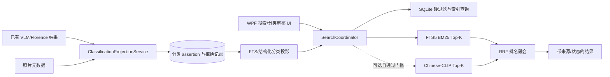

# 检索与自动分类技术 SDD（2026-10-16）

## 1. 系统边界

实现基于 WPF/.NET 8、Picer.Core 和 SQLite；原图只读。SQLite FTS5 是本地文字检索引擎与媒体文本投影的持久层，不新增 Elasticsearch/Milvus。Chinese-CLIP 是可选本地召回器，向量继续按模型版本写入本地 SQLite。首期全库分类仅针对本地照片索引；远程模式没有与本地一致的分类授权/写入协议前，显示只读不可用说明，不跨设备静默写分类。

分类生成只读取：

- 现有已完成 `cloud_vision_analyses` 中的 structured scenes/activities/objects/searchTerms；
- 已接受的 `florence_image_results`；
- 照片索引中的直接元数据。

首期分类按钮不启动 `ICloudVisionAnalyzer`，不新增费用，也不处理未描述照片的原图。没有既有视觉分析时只生成确定性元数据视图或显示未分类，并链接到现有描述任务。视觉结果按受控 `VisualConceptCatalog` 同义词映射；不能映射到已知概念的文本留作全文检索，不创建不受控 taxonomy。当前 Cloud VLM 输出没有逐类别校准置信度，所以其语义标签先归为待确认；只有以后某一模型/提示/类别组合通过固定离线门槛，才允许改为机器自动归类。

## 2. 结构概览

`SearchCoordinator` 和分类查询不依赖 UI，不直接执行网络调用；UI 提供用户操作、进度与解释。

## 3. 持久化与 schema 迁移

当前 schema 为 v46；迁移按 `PicerDatabase` 的连续 `user_version` 链添加 v47。遵循 AGENTS.md 的安全要求：关闭写入者、整组备份 DB/WAL/SHM、暂存迁移、验证完整性后发布。原照片、缩略图、现有用户标签/相册及人脸确认不参与破坏性变更。

### 3.1 受控分类目录

目录由 `VisualConceptCatalog` 版本化管理：稳定 `concept_id`、显示名、同义词、父级/多标签组、可搜索类别、隐私等级。目录首次实现限定少量已存在 concept IDs（季节、场景、活动、服饰等）；不允许 VLM 自由文本动态创建类别。未知词留在描述全文中。

### 3.2 断言、用户确认及拒绝作用域

断言保留原始来源；用户确认必须新建独立的 `source_kind=user` assertion，模型候选只更新审阅状态且继续保留 `vision_model` 来源。投影按内容身份和 concept 聚合来源，避免同一照片重复命中。删除模型候选不得删除用户 assertion 或既有 `image_tags`。

拒绝记录以经过验证的内容 SHA-256 为优先身份，逻辑唯一键为 `(content_sha256, concept_id, source_scope)`；哈希未知时回退为 `(image_id, concept_id, source_scope)`。禁止基于文件名、尺寸或感知哈希猜测等同。后续获得可信哈希时，事务性提升 image-scoped 拒绝，并仅传播给相同 SHA 的引用。具体列名服从可安全迁移实现，但必须表达这两类身份且不可相互碰撞。

纠正操作在单个事务中创建用户断言、拒绝旧机器候选并更新投影；同概念确认不创建拒绝。移除机器断言只作用于机器来源，人工来源始终保留。
### 3.3 从旧视觉概念迁移

- `image_visual_concepts.state='suggested'` 转为 `source_kind=vision_model, assertion_state=suggested`；普通搜索不再把它当成已生效分类。
- 旧 `accepted` 行缺少可证实的 actor/source，转成 `source_kind=legacy, assertion_state=legacy_effective`，保留现有搜索行为并在 UI 标为“旧版已生效（来源未记录）”，用户可以确认或移除。
- `visual_concept_rejections` 映射到新的拒绝记录；不得因模型版本变更丢失。
- migration 结束前对照片数量、概念数量、状态计数做一致性检查；异常中止，不发布不完整投影。
- 旧表至少保留一个兼容版本；确认所有读写路径改用新 repository 和迁移验证后，未来 migration 才可清理。

## 4. 分类流水线

### 4.1 读取和增量

扫描已索引的 active 图片数据库行，不遍历文件系统、不重新哈希、不解码原图。使用现有照片/描述版本和 source fingerprint 判定是否需要生成；输入未变化时跳过。读取分批，以 SQLite 有界事务写入。UI 可取消，取消只停止之后的批次，不回滚已经提交的有效批次。

### 4.2 候选映射及有效状态

现有 Cloud VLM/Florence 语义结果只映射为 suggested；没有逐类别质量门槛通过和登记的固定模型/提示版本时，禁止升级为 automatic。automatic 仅限直接可验证的元数据白名单：方向值、像素尺寸/尺寸关系、相机字段存在、GPS 字段存在等，且证据文本只能陈述可验证事实。GPS 存在不能推出户外，宽高比不能推出全景，拍摄小时不能推出黎明/黄昏；现有 AiSceneDetector 的这些语义启发式一律只能是 suggested，即使 confidence 高也不例外。新语义自动分类须先经逐类别离线评估并固定版本，再启用该类别门槛。

新模型结果不触碰 user_confirmed。拒绝按可信内容 SHA-256 + concept + source_scope 持续抑制同内容引用；hash 未知时按 image_id，后续可信哈希到达后安全事务提升。
### 4.3 状态操作

确认建议时，在一个事务中新增独立用户 assertion，将机器候选标记为已审阅/已接受，并重建聚合投影；绝不把机器来源 assertion 原地改成用户来源。若相同概念已有用户标签，保留并聚合来源，避免重复搜索结果。拒绝/撤销机器分类只更新机器候选和拒绝记录，不触及用户 assertion/tag。拒绝以验证过的内容 SHA-256 + concept + source_scope 为键；未知哈希时以 image_id 回退，且后续可信哈希到达时事务性提升。恢复忽略项只移除对应 rejection，并恢复为 suggested，不直接进入搜索。

手工改类是一个用户事务：创建新类别的 user assertion、拒绝旧机器类别、更新投影；不得把新类别写成模型事实。确认相同类别不产生 rejection。批量确认限同 concept，逐项报告失败；撤销只限本次操作且重放前验证 assertion 版本。
## 5. 搜索和排名

### 5.1 FTS/BM25 默认路径

继续使用 `ChineseSearchTokens` 的 FTS5 MATCH 参数化查询。为 `MediaTextRanking.Search` 加入可选 Top-K 和 cancellation 支持，避免对 UI/问答返回无界集合。硬条件构造独立于自由文本查询。直接的类别筛选默认匹配：用户确认、确定性 metadata、达标自动机器结果、明确标记为 legacy-effective；`suggested` 仅在请求的 `IncludeSuggestedClassifications=true` 时包含。

### 5.2 可选 CLIP + RRF

添加不依赖模型运行时的 `ReciprocalRankFusion` 单元模块；输入是稳定媒体 ID 和 rank，输出融合 rank/score 及来源 ranks。仅在设置为语义模式、已有对应当前 modelVersion embedding 时启用；AI 问答第一迭代维持 BM25-only，直到影子评测证明改变安全。

CLIP 查询增加批次读取、Top-K 堆、批次边界 cancellation 和缺失向量统计；只对指定 modelVersion 计分。过滤 ID 作为评分过程的硬谓词，不允许先全库截断再做硬过滤。使用逐模型文件/source fingerprint，模型版本不同绝不混算。首期接受 O(N·d) 扫描，性能基准不合格时融合仍保持 opt-in，后续才评估 ANN。

RRF `score(d)=Σ 1/(k+rank_i(d))`，`k=60` 是可配置起始参数。记录每个命中源、原始 rank 和过滤原因，UI 不显示伪精确概率。硬条件先统一应用/验证，再融合各来源；地名/日期语义遵循 UX 文档中的硬条件与软提示定义。

### 5.3 搜索来源

搜索结果模型增加 `MatchSources`（FTS, CLIP, user-confirmed, metadata, machine-auto, suggested）及各通道 rank/概念 ID。AI 答案只能把已确认结果表述为程序确认；机器分类须附带机器来源语义；建议必须标“待确认”。日志只记录来源代码、耗时和脱敏数量，不记录搜索问题、人员姓名、向量、描述正文或凭据。

## 6. UI 与应用服务边界

- 新窗口由 `AI 功能` 菜单启动，可复用 MainViewModel 的 `ClientServices` / 数据库调度器。
- 全库范围通过索引 SQL查询确定，不使用目录遍历或预扫；选中图片上下文提供同一 viewmodel/service 的受限范围。
- 分类审核为独立模块，不挤占普通浏览搜索资源；后台 CPU/SQLite 写入有节流，数据库操作走现有 UiWork/调度器。
- 每批事务提交后发布进度，关闭窗口不取消，只有明确点暂停/取消才停止。
- 错误使用稳定代码，UI 展示用户可操作信息；不得泄漏模型响应或隐私文本。
- 远程模式第一期禁用写入与运行按钮，说明当前只支持本地索引；不能把本地的机器结果错误呈现为服务端账户空间的共享分类。

## 7. 质量、性能和隐私

- 分类：离线固定样本逐类报告 precision、recall、coverage、abstention、95% 置信区间和分组错误；校准集、门槛集、最终验收集隔离，按事件/连拍/近重复分组。门槛集在编码开始前登记，未达门槛只输出建议。
- 检索：同一 photo-only 查询子集评测 BM25-only/CLIP-only/RRF，query bootstrap 置信区间及预登记非劣界值；视频结果独立报告，硬过滤违规为零。
- 性能：实施前冻结代表性 Windows x64 CPU/GPU、照片总数（含 10 万张目标档）、向量覆盖率、冷/暖缓存；登记建索引吞吐、search p50/p95、内存和取消延迟 SLO。没达到 SLO 则功能可选且 BM25 默认不变，不以增加并发作为唯一补救。
- 隐私：CLIP encoder/向量查询全本地；描述分析仍遵循独立 cloud opt-in。查询文本、照片、向量和人工评估标注不得默认同步上传。SQLite 参数化查询、模型/类别数据验证和日志隐私规则沿用现有约束。

## 8. 测试设计

- Migration：v46 空库、完整旧库、旧 suggested/accepted/rejection、重复运行/中断回滚和 DB integrity；验证图片、tags/albums、face assignments 不变。
- Repository：来源隔离、幂等重跑、模型升级不覆盖用户确认、拒绝跨版本有效、恢复只回建议、机器撤销不删同标签用户来源、内容移动后继承拒绝。
- Search：默认排除 suggested、显式 inclusion、automatic/user/metadata/legacy 分别命中；明确人物/date/GPS hard filter 对 BM25/CLIP/RRF 一致；软地点/季节不构成错误硬过滤。
- RRF：来源交并、rank、同 rank 稳定 tie-break、重复媒体去重、空通道退化、取消、模型版本隔离。
- Background job：只查询 active indexed photos、no filesystem scan/hash/decode/cloud request、增量跳过、部分提交、取消/恢复、单项失败重试、UI 关闭后结果一致。
- WPF UIA：菜单入口、首次空状态、开始/暂停/继续、待确认/自动/人工/忽略/未分类/失败、单项和同类批量操作、搜索建议开关、撤销及键盘/automation names。
- Performance: synthetic 10k/100k/representative collection; cap memory and assert batch cancellation bounds; report p50/p95. Runtime-dependent CLIP model test retains RuntimeComponent category and does not misrepresent ordinary CI as having run it.

## 9. 部署与回退

本功能属于桌面端/数据库变更，不要求生产服务端升级。schema migration 可恢复，分类投影可从旧分析/元数据重建。若新分类引发搜索回归，通过 feature flag 关闭机器类别默认召回/关闭 RRF；保留原 FTS、用户 tags、描述和原照片。回滚 UI 版本不得降级数据库 schema；使用已有 migration forward-repair 策略。

实现冲突、来源隔离、内容级拒绝、自动分类白名单及任务恢复契约以[最终实现裁定](SEARCH_AND_AUTO_CLASSIFICATION_DECISIONS_2026-10-16.md)为准。
