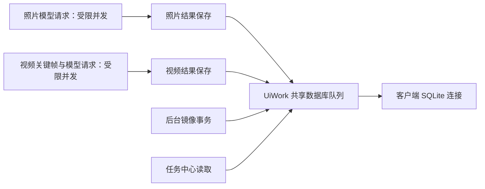

# 代码与文档系统审查、边界功能补齐

<!-- historical-status-2026-10-09 -->
> **历史资料，2026-10-09 状态对照**：正文保留该阶段设计、测试和部署证据；其中“当前”“待办”“已部署”及验收数字按当时语境理解，不代表最新程序状态。
> 当前能力见[当前能力与验证状态](CURRENT_CAPABILITIES_2026-10-09.md)，后续结果见[最新代码修复与验证](RESIDUAL_CODE_FIXES_2026-10-09.md)。当前源码 schema 45；605 项单元用例由完整回归与补测分轮去重核验，WPF 73/73，不是一次全量 605/605，也不证明历史部署包包含新代码。
> 后续替代：本文初审代码缺口已由后续修复关闭；目录跟踪现支持持久 NTFS USN 连续水位，视频内容及派生证据按内容共享，移动修复和手动清除覆盖视频，本地照片/视频均有界并发。尚需真实设备/模型验证的边界仍保留，不能把初审建议重新列为当前代码待办。
<!-- /historical-status-2026-10-09 -->

> 后续状态：用户随后授权修复下述未关闭问题。实施记录与当前状态见 [审查修复记录](SYSTEM_REVIEW_FIXES_2026-10-09.md) 和 [当前能力矩阵](CURRENT_CAPABILITIES_2026-10-09.md)。本文保留初次审查的发现与验证证据，不作为后续剩余任务清单。

## 范围与方法

本次按用户要求组织功能/契约、健壮性/恢复、性能/并发三个并行专项审查，主审负责易用性、交叉核对、集成和验证。审查依据为当前源码、调用链、已有测试及脱敏任务记录，不以旧报告的“完成”状态代替验证。

用户另行要求实现视频移动重新关联、视频描述并发、减少重复子树枚举，并调查三项照片描述失败。本轮仅修复这些功能及审查中紧邻的明确缺陷；结构性问题保留为具名待办，不将 review 完成等同于全部风险消除。

人脸质量、人工标注 ASR 对照、真人 AEC3、低显存方案这四项旧 P2 按要求暂停。下面的 P1/P2 是新审查发现的严重性，不表示恢复旧任务。

详细证据与代码行号：

- [功能完整性与契约](SYSTEM_REVIEW_FUNCTIONAL_2026-10-09.md)
- [健壮性与失败恢复](SYSTEM_REVIEW_ROBUSTNESS_2026-10-09.md)
- [响应性能与并发](SYSTEM_REVIEW_PERFORMANCE_2026-10-09.md)

这些是代码审查和针对性验证，不是逐行形式化证明；没有对真实图库做破坏性或大规模压力试验。尚未测量的性能风险在分报告中明确标注。

## 三项照片失败的根因

只读核对真实镜像任务表，三项对应相同错误：`SqliteConnection does not support nested transactions`。最近发生时间为 **2026-10-09 10:39:40（北京时间）**，早于上一轮 11:56 更新启动。这不是照片内容不支持或模型 HTTP 502 的证据。

代码中同一 SQLite 连接被描述保存和后台镜像事务使用。目录批量入口在前轮已接共享数据库队列，但普通照片描述工厂仍只有服务实例自己的锁，两个入口及镜像可能交叠。本轮工厂统一注入 `UiWork.RunDatabaseAsync`；任务中心的列表/重试读取也进入同一队列。新增回归模拟两个分析服务完成推理时镜像仍持有事务，验证等待释放后保存，不产生嵌套事务。

没有删除历史失败记录、伪造成功状态或重调这三张照片的真实模型。代码修复与历史任务重试是两件事；再次描述时有效结果自动跳过，失败项仍可重试。其他窗口还有绕过统一执行器的调用，不能据此宣称全应用数据库并发审计已闭环。

本轮接入的客户端路径如下，模型请求不占数据库队列：

服务端关键帧保存使用独立连接和短事务，由 SQLite 协调写入；不是通过给客户端多开工作线程来并发操作同一个连接。其他服务端端点和窗口的连接所有权仍需按待办继续审计。

## 本轮已实现

| 项目 | 行为与约束 |
|---|---|
| 视频移动修复 | schema42 以事务新增视频 SHA-256；多个新根目录按内容身份关联原视频 ID，保留摘要、转写、关键帧、人物确认/忽略/拒绝、标签。执行前重新核验目标；无法确认的保留为缺失。复制视频派生结果时计费用量置零，避免复用被重复计入费用预算。 |
| 视频并发 | 本地照片及视频各支持 1～4 路，默认2；先照片批次、后视频批次，云端仍串行。视频模型调用可以重叠，数据库读写走公共短队列，同视频操作有互斥；取消等待在途任务退出。拼图临时写入后原子替换，取消不留下半成品。 |
| 目录变更跟踪 | 进程内最多4个根目录列表缓存，监控脏目录并核对目录修改时间，未变化目录不重新枚举文件。首次、重启、监控断档/溢出、强制或周期校验回退完整枚举；不完整扫描不授权缺失推断。驻留程序枚举移到后台，不阻塞取消消息接收。 |
| 照片保存事务竞争 | 普通照片描述工厂和目录入口使用相同数据库执行器；视频描述读写同步接入，任务中心共享读取统一。 |
| 照片同步分批错误 | `PushImagesAsync` 原来每200张循环却发送整个来源集合，改为仅发送当前batch；401条应为200/200/1，每ID恰好一次。 |
| 隐私与任务文案 | 本地模型提示明确远程索引服务也会收到中转数据；任务列表“共”改为“最近”，目录描述原因中文化；修复菜单包含视频。 |
| 文档对齐 | 用户指南补齐新流程和兜底；SDD/AGENTS区分源码schema42与实际部署版本，修正IndexService“只读网关”的过时表述。 |

必须保留的边界：旧视频没有哈希且原文件已丢失，无法可靠补出原内容身份；需在移动前完成一次新版扫描。相同视频多副本目前复制派生记录，**不是内容级唯一视频索引**。变更跟踪**不是跨重启 NTFS USN 日志**；仍检查已知目录/文件元数据，默认约十分钟完整核对，不能宣称每次扫描只需处理变化文件。文件系统元数据和事件都有时序限制，完整校验入口保留。

## 未关闭问题：建议优先顺序

| 优先级 | 问题 | 影响与验收方向 |
|---|---|---|
| P1 | 人脸重新检测先删除同模型旧记录 | 级联清除人工归属、拒绝和审阅；需稳定ID匹配、事务替换、重复检测保留人工状态及中途失败回滚测试。见R-03。 |
| P1 | 普通启动数据库迁移缺少统一备份与旧库原子恢复 | 发布脚本备份无法覆盖用户直接打开旧库；需迁移前关闭文件备份、逐版本故障注入和重启恢复。见R-04。 |
| P1 | 镜像按照片数量相等跳过同步 | 同数量改名/移动/替换可能继续使用陈旧路径；需可信变更水位或增量版本。见PERF-03。 |
| P1 | 扫描每一页都重新读取全源照片和全库视频 | 文件枚举优化后数据库阶段仍可能成为主要瓶颈；需页内查询和一次性轻量缺失快照。见PERF-02。 |
| P1 | 多人别名问答漏掉人物交集 | 用两个别名查询合影可能只约束一个人物；需统一全体人物提及解析、照片/视频交集回归。见F-01。 |
| P1/P2 | 大任务结果全量复制、base64长期落盘，日志无限增长 | 并发音频引起内存与磁盘放大、重启扫描成本增长；需流式结果、TTL/配额、分页状态表。见R-05/R-06、PERF-08。 |
| P2 | 其他窗口绕过共享SQLite执行器 | 人物详情等使用Task.Run不等于连接线程安全；需梳理连接所有权并做镜像+编辑+描述并发回归。 |
| P2 | 缩略图去重共享首个调用者取消令牌 | 一个卡片离屏会取消仍可见卡片下载，旧finally可能移除新任务；需取消等待与下载生命周期分离。见PERF-06。 |
| P2 | 大资源缓存全局串行与同步哈希 | 长视频阻塞小照片、取消响应慢；需内容锁+有界并发及可取消哈希。见PERF-07。 |
| P2 | 目录预览/目录树全量工作 | 快速切换累积无效SQL、UI全量控件创建；需取消防抖、批量状态查询、去重树模型和懒加载。见PERF-04/05。 |
| P2 | AI复核JSON null、姓名子串约束、视频地点召回不对称 | 分别需结构校验回退、最长提及匹配、照片视频统一GPS召回测试。见F-02/03/04。 |
| P2 | 费用预算依赖可覆盖的描述记录，缺少请求费用流水 | `CloudVisionRepository.GetEstimatedCostSince` 汇总当前分析/摘要行；`VideoRepository.SaveSummary` 按video_id覆盖同一行，多次付费分析会覆盖旧费用，不能代表累计支出。需独立不可变请求账目与预算预留；用同一媒体两次付费请求验证累计额。此项不同于本轮已修的“复制副本重复计费”。 |

## 易用性补充审查

1. **失败解释与重试入口尚不统一**：目录窗口主要显示累计成功/失败数，照片可在任务中心查历史，视频缺少同等逐项失败记录入口。`DirectoryMediaDescriptionWindow.StartAsync` / `MediaDescriptionBatch.RunOne` 应输出可供UI显示的结构化逐项结果、阶段和可重试性，区分扫描失败、模型失败、保存失败及用户取消；日志继续避免原图路径和模型原文泄漏。
2. **任务中心定位依赖本机路径**：`CloudVisionTaskCenterWindow.TasksGrid_MouseDoubleClick` 直接 File.Exists + explorer。远程图库照片存在于源代理却不在本机时会被提示不可用。应调用媒体网关或明确“在源电脑定位”，不能把本机不存在等同源文件已删除。
3. **预览与运行范围容易混淆**：目录预览来自当前索引，扫描后新增项才计入最终确认。已有文字说明，但建议显示“索引预览/扫描结果”状态和变化数量；运行结束按成功、复用、失败、取消分别汇总。
4. **历史文档与当前状态混用**：DEVELOPMENT_PLAN 等保留不同日期的“全部完成”与旧schema说明。顶层已补本轮入口，旧内容应作为历史而非执行清单；后续维护单一当前能力矩阵，给每项标明源码、测试、发布和真实验收四种状态。
5. **本地/云端术语仍有残留混用**：普通照片描述完成、取消和错误提示及任务中心标题仍固定写“云端”，即使实际选择本地模型。此次修正了关键数据流确认文案，但未重命名全部菜单/资源；后续统一为“照片分析”并展示实际模型来源，配套中文UI自动化断言。

## 验证与交付

- `dotnet restore picer.sln` 成功；严格 Debug 构建零警告、零错误。
- 完整非 RuntimeComponent 单元回归 **464/464** 通过，证据 `artifacts/system-review-tests/system-review-units-final.trx`。修复后的首组定向 **16/16** 通过。
- 首轮失败记录保留：目录监控事件尚未稳定的测试竞态、两个测试清理时连接池未释放、最小旧库夹具缺少视频表，以及视频派生复制与触发器预建文字索引冲突；已分别修正并复测。没有隐藏失败输出或放宽数据保护规则。
- 完整单元回归之后，集成复核将服务端视频查询与关键帧事务改为独立连接，并补并发关键帧保存测试。最终严格构建仍零警告、零错误；网关/照片描述/视频修复/目录跟踪等定向 **111/111**、新增关键帧并发 **1/1** 通过，分别见 `system-review-final-delta.trx`、`system-review-keyframe-concurrency.trx`。不把此前464项冒充覆盖后加的测试。
- 完整非 RuntimeComponent WPF 回归 **69/69** 通过，见 `system-review-wpf.trx`，包括本地照片及视频的并发上限、取消后等待工作退出、目录树视频节点和既有窗口测试。
- `git -c core.whitespace=cr-at-eol diff --check` 通过。未增加新的编译告警抑制。

实际数据库和线上服务未因审查自动迁移；源码新增schema42，真实部署前必须对所有写入者停机备份DB/WAL/SHM，并按客户端、源代理、索引服务的契约一起升级。本轮不将旧发布目录视作已含本次改动。
